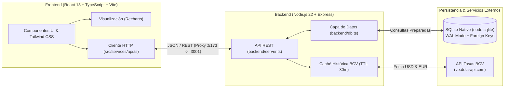

# 💰 Gestor de Gastos Mensuales & Analítica Cambiaria (BCV)


Aplicación **Full-Stack** de finanzas personales y control presupuestario diseñada para entornos multimoneda de alta volatilidad. Permite registrar, categorizar y auditar gastos en **Dólares (`USD`)**, **Euros (`EUR`)** y **Bolívares (`VES`)**, integrándose en tiempo real con las tasas oficiales históricas y diarias del **Banco Central de Venezuela (BCV)** para calcular automáticamente el **impacto cambiario (ganancia o pérdida por devaluación/apreciación)**.

---

## 🎯 Problema que Resuelve (Caso de Estudio)

En economías bimonetarias o con fluctuación cambiaria diaria, llevar la contabilidad en una sola moneda distorsiona la realidad financiera:
1. **Desfase Fecha de Operación vs. Fecha Valor BCV**: Las tasas publicadas un día hábil por la tarde entran en vigencia el siguiente día bancario, lo que suele causar discrepancias al conciliar estados de cuenta.
2. **Erosión o Ahorro Cambiario**: Un gasto pagado en moneda local (`VES`) o en `EUR` tiene un equivalente en `USD` al momento de la compra, pero un valor distinto al cierre del mes o del día actual.
3. **Distorsión por Suscripciones Anuales**: Los pagos recurrentes anuales o mensuales pueden inflar artificialmente el flujo de caja operativo de un mes si no se pueden segregar dinámicamente.

Este proyecto aborda estos tres desafíos mediante un motor de conversión histórica con caché en memoria, trazabilidad de la moneda original de cada transacción y analítica visual interactiva.

---

## ✨ Características Principales

### 💱 1. Motor Multimoneda e Integración Histórica BCV
- **Conversión Automática a Moneda Base (`USD`)**: Registro nativo de gastos en `USD ($)`, `EUR (€)` o `VES (Bs.)`.
- **Consulta Histórica Inteligente**: Al seleccionar cualquier fecha pasada en el formulario, el sistema consulta automáticamente la tasa oficial del BCV correspondiente a ese día exacto.
- **Soporte de Fecha de Publicación vs. Fecha Valor**: Permite alternar con un clic entre la tasa publicada en la fecha seleccionada y la tasa con fecha valor vigente de la jornada previa.
- **Modo Manual / Tasa Personalizada**: Posibilidad de sobrescribir la tasa en cualquier transacción o editarla posteriormente con recálculo instantáneo.

### 📈 2. Análisis de Ganancia o Pérdida Cambiaria
- Cálculo diferencial entre el **valor histórico en `USD`** (al momento del gasto) y el **valor reexpresado a la tasa BCV actual**.
- Indicadores individuales por movimiento y tarjetas de balance consolidado tanto en el **Resumen Mensual** como en el **Resumen Anual**.

### 📊 3. Visualización de Datos Interactiva (Recharts)
- **Dashboard Mensual**: Gráfico de dona (*Donut Chart*) interactivo con desglose porcentual por categoría y barras de progreso hacia subcategorías.
- **Comparativa de Evolución (6 Meses)**: Gráfico de área (*AreaChart*) con línea de promedio móvil de 6 meses y matriz expandible Categoría → Subcategoría para detectar desviaciones de gasto.
- **Resumen Anual**: Gráfico de barras apiladas (*Stacked BarChart*) de los 12 meses del año (Gastos Operativos vs. Suscripciones), KPIs de mes pico, promedio mensual y distribución anual.

### 🔄 4. Gestión de Suscripciones y Pagos Recurrentes
- Panel dedicado para administrar membresías y servicios de cobro **Mensual** o **Anual**.
- **Conmutador de Impacto Presupuestario**: Control global e individual para decidir si las suscripciones se suman al flujo de gastos mensuales o se mantienen aisladas en el presupuesto anual.

### 🗂️ 5. Categorías, Subcategorías y Edición en Línea
- **CRUD Completo de Categorías y Subcategorías**: Selector de color personalizado, renombrado en vivo y protección de integridad referencial (reasignación automática si se elimina una categoría en uso).
- **Edición en Línea de Movimientos**: Modificación directa de descripción, fecha, categoría, subcategoría, moneda, monto original y tasa BCV desde el historial de movimientos sin perder el contexto.

---

## 🏗️ Arquitectura del Sistema



### Decisiones Técnicas Destacadas
- **Zero-External-ORM con `node:sqlite`**: Uso del módulo nativo `node:sqlite` introducido en Node.js 22 (`DatabaseSync`), eliminando dependencias pesadas de compilación nativa C++ (`node-gyp`) y garantizando consultas síncronas ultrarrápidas con `PRAGMA journal_mode = WAL`.
- **Migraciones Automáticas Idempotentes**: Al iniciar el servidor, `backend/db.ts` verifica el esquema existente, ejecuta migraciones de columnas faltantes sin pérdida de datos y siembra las categorías base si la base de datos es nueva.
- **Resiliencia en Consultas Externas**: El backend mantiene en caché las series históricas de `USD` y `EUR` con un TTL de 30 minutos y degradación elegante (*graceful fallback*) en caso de intermitencia de la API externa.

---

## 🗄️ Modelo de Datos (SQLite)

| Tabla | Descripción | Campos Clave |
| :--- | :--- | :--- |
| `categories` | Categorías principales de gasto | `id`, `name`, `color`, `is_custom` |
| `subcategories` | Subdivisión jerárquica por categoría | `id`, `category_id` (FK), `name` |
| `expenses` | Registro transaccional multimoneda | `id`, `amount` (USD), `original_currency`, `original_amount`, `exchange_rate`, `category`, `subcategory`, `description`, `date`, `month` |
| `subscriptions` | Pagos recurrentes mensuales/anuales | `id`, `name`, `amount` (USD), `original_currency`, `original_amount`, `exchange_rate`, `billing_cycle`, `category`, `subcategory`, `include_in_monthly`, `active` |
| `settings` | Preferencias globales del usuario | `key`, `value` |

---

## 🔌 Endpoints Principales de la API REST

| Método | Ruta | Descripción |
| :--- | :--- | :--- |
| `GET` | `/api/bcv-rate` | Obtiene la tasa oficial vigente del día para `USD` y `EUR` en Bolívares. |
| `GET` | `/api/bcv-rate/history?date=YYYY-MM-DD` | Obtiene la tasa histórica exacta para una fecha dada (fecha de publicación y fecha valor previa). |
| `GET` | `/api/expenses?month=YYYY-MM` | Lista los movimientos del mes ordenados cronológicamente. |
| `GET` | `/api/expenses/analytics` | Devuelve agregaciones multimensuales y anuales optimizadas en SQL. |
| `POST` | `/api/expenses` | Registra un nuevo gasto con su trazabilidad cambiaria. |
| `PUT` | `/api/expenses/:id` | Actualiza un movimiento existente y recalcula su equivalencia en `USD`. |
| `DELETE` | `/api/expenses/:id` | Elimina un movimiento por ID. |
| `GET / POST / PUT / DELETE` | `/api/categories` & `/api/subcategories` | Gestión completa de categorías y subcategorías con actualización en cascada. |
| `GET / POST / PUT / DELETE` | `/api/subscriptions` | CRUD de suscripciones y configuración global de inclusión mensual/anual. |

---

## 🚀 Instalación y Ejecución Local

### Prerrequisitos
- **Node.js v22.5.0 o superior** (requerido para el soporte nativo de `node:sqlite`).
- **npm** v10+.

### Pasos para levantar el entorno de desarrollo

1. **Clonar el repositorio:**
   ```bash
   git clone https://github.com/Jeyz29/Proyecto-Gestor-de-gastos.git
   cd Proyecto-Gestor-de-gastos
   ```

2. **Instalar las dependencias:**
   ```bash
   npm install
   ```

3. **Iniciar el servidor Full-Stack (Backend + Frontend simultáneamente):**
   ```bash
   npm run dev
   ```
   - **Frontend (Vite):** Disponible en `http://localhost:5173`
   - **Backend (Express + SQLite):** Corriendo en `http://localhost:3001` (conectado automáticamente vía proxy de Vite).
   - *Nota: La base de datos local `backend/gastos.sqlite` se generará automáticamente en el primer arranque con las categorías iniciales.*

4. **Verificar tipado y compilación de producción:**
   ```bash
   npm run build
   ```

---

## 📂 Estructura del Proyecto

```text
├── backend/
│   ├── db.ts                            # Inicialización SQLite, esquema, migraciones y seeders
│   └── server.ts                        # API REST Express, caché BCV y lógica de negocio
├── src/
│   ├── components/
│   │   ├── categories/
│   │   │   └── CategoryManagerModal.tsx # Gestión CRUD de categorías y subcategorías
│   │   ├── expenses/
│   │   │   ├── AnnualSummaryView.tsx    # Dashboard anual, KPIs y gráficos de 12 meses
│   │   │   ├── ExpenseForm.tsx          # Formulario multimoneda con tasa histórica BCV
│   │   │   ├── ExpenseList.tsx          # Historial con edición en línea y badge cambiario
│   │   │   ├── MonthlyComparisonView.tsx# Evolución de 6 meses y tabla comparativa
│   │   │   └── MonthlySummary.tsx       # Resumen mensual, Donut chart y balance cambiario
│   │   └── subscriptions/
│   │       └── SubscriptionsView.tsx    # Gestor de pagos recurrentes mensuales y anuales
│   ├── services/
│   │   └── api.ts                       # Cliente de comunicación tipado hacia el backend
│   ├── types/
│   │   └── index.ts                     # Interfaces y contratos TypeScript compartidos
│   ├── utils/
│   │   └── formatters.ts                # Formateadores de moneda, fechas y períodos
│   ├── App.tsx                          # Layout principal, navegación y estado global
│   └── main.tsx                         # Punto de entrada de React
├── index.html
├── package.json
├── tsconfig.json
└── vite.config.ts                       # Configuración de Vite, Tailwind v3 y Proxy API
```

---

## 👤 Autor

Desarrollado por **Guillermo** ([@Jeyz29](https://github.com/Jeyz29)) como proyecto de portafolio Full-Stack (React + TypeScript + Node.js + SQLite).
